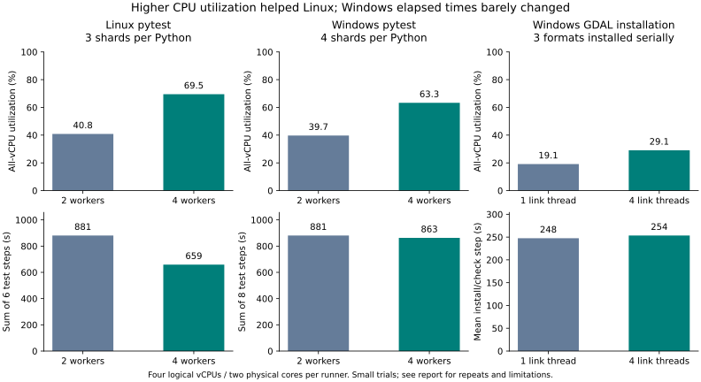

# Runner CPU and I/O experiments — November 4, 2026

**Follow-up:** [Additional tracing and full Windows matrices](FOLLOWUP-RESULTS.md)
now support four Windows workers with `--dist=worksteal`. They locate the
observed Ibis bottleneck in Mamba and supersede the provisional Windows
recommendation below. This document preserves the initial experiment results.

These measurements use PR #972 at `b32d4e58b909cc9011684970f621f64f9fe73506`.
Product code, dependency locks, test coverage, and action pins are unchanged.
The experiment branch is `maresb/conda-lock:experiment/ci-performance-20261104`.

Linux pytest benefits from explicitly using four workers. Windows pytest and
Conda installation show why spare logical CPU capacity does not, by itself,
justify increasing concurrency. The earlier measurements were job/step timings;
the experiments below add direct runner utilization measurements.

## Measurement method

The sampler records system-wide utilization for each logical CPU once per
second, alongside disk/network counters, available memory, and CPU-time deltas
for visible processes. Each workflow phase has explicit timestamp markers.
Reported CPU percentages are time-weighted fractions of **all four logical
vCPUs**. For example, 25% corresponds to approximately one busy vCPU.

Both Linux and Windows runners reported four logical vCPUs and two physical
cores. Logical utilization measures busy time, not instruction throughput;
hyperthreading does not double the execution resources of two physical cores.
The existing pytest `--numprocesses=auto` setting creates two workers here.
[pytest-xdist documents this distinction](https://pytest-xdist.readthedocs.io/en/stable/distribution.html).

The [hosted calibration](https://github.com/maresb/conda-lock/actions/runs/41885058427)
measured 0.35% CPU at idle and 98.4% under a four-process CPU load on Linux;
Windows measured 2.9% and 96.3%. The initial counter reading is discarded.
Samples are approximately one second apart; the analysis clips labeled samples
to GitHub's recorded step boundaries when available. Boundaries still have about
one second of uncertainty. Process deltas miss short-lived processes, so their
totals are diagnostic rather than a complete accounting of CPU work.

Measurements cover environment setup, installation, and test steps. They
exclude checkout, telemetry bootstrap, queueing, and post-job cleanup.
The observer runs in its own pinned Python/psutil environment. Its CPU usage is
recorded, and included in system-wide measurements rather than subtracted.
Instrumented job runtimes include the extra bootstrap and idle calibration;
they must not be presented as predicted production CI completion times.

## Linux pytest: two versus four workers

Both variants keep three shards per Python version, coverage enabled, and warm
environment caches. The runs are sequential for the Linux matrix.

| Metric | Two workers (`auto`) | Four workers |
| --- | ---: | ---: |
| Mean CPU during pytest | 40.8% | 69.5% |
| Mean busy vCPUs | 1.63 | 2.78 |
| Time at >=80% CPU | 4.4% | 43.9% |
| Sum of six pytest step times | 881s | 659s |
| Slowest pytest step | 183s | 127s |
| Matrix span, including instrumentation | 228s | 164s |
| System CPU-seconds during sampled test phases | 1,437 | 1,826 |

All six jobs passed in each variant. Cache restoration succeeded in every job.
Each Python version retained the same 344 test IDs. Four workers reduced summed
pytest time by **25.2%** and the longest test step by **30.6%**, while consuming
more CPU-seconds. This is evidence of a completion-time benefit, not a claim of
less CPU work. These are one controlled pair of full matrices, not a stable
latency distribution or an end-to-end CI benchmark.

Sources: [two-worker control](https://github.com/maresb/conda-lock/actions/runs/41885415752),
[four-worker run](https://github.com/maresb/conda-lock/actions/runs/41886256501).

## Windows pytest

The [original ten-shard run](https://github.com/maresb/conda-lock/actions/runs/41888476427)
and [four-shard control](https://github.com/maresb/conda-lock/actions/runs/41889214378)
both use two pytest workers per runner. All 20 and eight jobs respectively passed
and restored their environment caches. Each Python version retained exactly the
same 344 test IDs.

| Metric | Ten shards/Python, two workers | Four shards/Python, two workers | Four shards/Python, four workers |
| --- | ---: | ---: | ---: |
| Mean CPU during pytest | 38.2% | 39.7% | 63.3% |
| Sum of pytest step times | 1,231s | 881s | 863s |
| Slowest pytest step | 96s | 161s | 171s |
| System CPU-seconds during sampled test phases | 1,875 | 1,395 | 2,176 |

The [four-worker matrix](https://github.com/maresb/conda-lock/actions/runs/41890163071)
also passed all eight jobs with warm caches and the same 344 IDs per Python.
Utilization increased substantially, but summed test time fell only 2.0%, and
the slowest step increased 6.2%. In Python 3.14's second shard,
`test_lock_poetry_ibis` rose from 36.4s to 134.2s. The additional CPU activity
does not establish a Windows latency improvement.

A [focused repeat](https://github.com/maresb/conda-lock/actions/runs/41891570593)
ran Python 3.14 shard 2/4 twice per worker setting, concurrently on separate VMs.
All four jobs restored their caches, passed, and retained the same 86 test IDs
(67 passed, 19 skipped). This is a shard repeat, not another full-suite run.

| Workers | Repeat 1: step / CPU | Repeat 2: step / CPU | Mean step |
| --- | ---: | ---: | ---: |
| Two | 93s / 36.6% | 104s / 41.9% | 98.5s |
| Four | 130s / 44.3% | 66s / 64.2% | 98.0s |

The original 134s Ibis outlier did not recur: it took 30–42s in these repeats.
Instead, the slow four-worker repeat recorded about 58s each for
`test_v3_0_2_hash_compatibility`, `test_parse_environment_file`, and
`test_parse_poetry_default_pip`; they finished within 0.11s of one another.
CPU averaged 18.3% from 18:55:33 to 18:56:30 UTC, with at least 11.8 GiB of
available memory. This was not a sustained CPU-capacity shortage.

All three tests use the default PyPI mapping. The code in
[`lookup_cache.py`](../../conda_lock/lookup_cache.py) holds a shared file lock
while issuing `requests.get` without an explicit timeout. A delayed mapping
download blocking other workers is therefore a plausible explanation, not a
confirmed trace-level diagnosis: passed-test logs do not expose those captured
HTTP/lock events. Investigate that shared dependency before increasing Windows
worker counts. Priming the mapping before pytest is a useful next controlled
variant, but must be judged on total job time so moving a wait into setup is not
mistaken for eliminating it. The missing HTTP timeout is a separate robustness
issue; this experiment does not change product code.

In the original layout, the 20 cached-environment restore phases averaged about
20% CPU and consumed 14.5 runner-minutes. Thus reducing shards eliminates
substantial duplicated setup without resolving the low utilization within each
test job. Windows baseline profiling overlapped the independent installation
experiments on separate VMs; queue-dependent matrix elapsed time is not used
for a causal comparison.

## Windows installation utilization

The [profiled installation controls](https://github.com/maresb/conda-lock/actions/runs/41885415752)
use one producer's identical lockfile artifact for both serial controls and two
three-format parallel batches. Consumer runners start with cold package caches.

Serial installation/check steps averaged **23.2% CPU** across their two
repetitions, with individual means of 25.3% and 20.1%. The six isolated-format
jobs averaged **23.8% CPU**, ranging from 22.0% to 26.4%. Python accounts for most
of the visible process CPU time. Thus the allocated four-vCPU capacity is far
from saturated during most of this work.

In serial repeat 1, aligning Conda's completed verification/transaction log
messages with the CPU samples gives the following approximate linking phases:

| Format | Transaction elapsed | CPU utilization | Busy vCPUs |
| --- | ---: | ---: | ---: |
| Unified lock | 42.7s | 15.8% | 0.63 |
| Explicit | 41.3s | 16.1% | 0.64 |
| Environment YAML | 47.3s | 20.8% | 0.83 |

These intervals are bounded by emitted log messages, not an internal Conda
profiler. Disk and network counters show activity; they do not alone establish
device saturation or identify the cause of waiting.

## Same-runner format concurrency

The exploratory variant runs all three format checks concurrently on one VM,
with separate package caches. Every format still checks installation,
`conda list`, `gdalinfo`, and importing `toolz`. It downloads the exact lockfiles
from the profiled control run rather than solving again.

The [first two repetitions](https://github.com/maresb/conda-lock/actions/runs/41886981578)
passed, but placed caches on `D:` while environments were on `C:`. They wrote
12.7–13.4 GiB and took 190s and 284s in the installation step.
They are cache-placement diagnostics, not a fair estimate of the intended
change. In addition to repeating extraction for three cold caches, this layout
prevents hard-link reuse across volumes.
[Conda recommends keeping caches and environments on the same volume](https://docs.conda.io/projects/conda/en/stable/user-guide/configuration/custom-env-and-pkg-locations.html).

The [corrected repetitions](https://github.com/maresb/conda-lock/actions/runs/41888244372)
kept both caches and environments on `C:`. Both passed all checks, but the
installation steps took **276s and 493s**, versus **241s and 161s** in the earlier
serial controls. The corresponding sampled phases averaged 38% and 28% CPU and
wrote 8.2 and 9.3 GiB. This is a negative result: higher utilization did not make
this variant faster. Independent cold caches still repeat package downloads and
extraction, and all three installations share one VM's resources. Do not replace
the across-runner split with this implementation.

## Conda linking threads

[Conda documents `execute_threads=1` as the default](https://docs.conda.io/projects/conda/en/stable/user-guide/configuration/settings.html#execute-threads).
The final control keeps the original three serial format installations and shared
package cache, varying only `CONDA_EXECUTE_THREADS` between one and four. Each
setting has two repetitions using the same frozen lockfile artifact. Every job
prints the effective setting and retains all installation checks. This avoids
the repeated cold-cache work in the same-runner concurrency variant.

All four [thread-control jobs](https://github.com/maresb/conda-lock/actions/runs/41890163071)
passed, and their logs confirm the effective settings during installation.

| Metric | One linking thread | Four linking threads |
| --- | ---: | ---: |
| Installation/check step, repeat 1 | 275s | 262s |
| Installation/check step, repeat 2 | 220s | 245s |
| Mean step time | 247.5s | 253.5s |
| Time-weighted CPU utilization | 19.1% | 29.1% |

Four threads increased CPU work without improving mean completion time in these
two repetitions. Keep the default; these data do not support a linking-thread
increase as a performance fix. Together with the format-concurrency experiment,
this shows why low CPU utilization alone is insufficient to select an optimization.

## Implications for #969 and the original CI bottleneck

1. Explicitly use four pytest workers on Linux. The measured test-phase benefit
   is substantial, although a repeated latency distribution remains unmeasured.
2. Keep Windows worker count at two for now. Four workers increase utilization
   but have not demonstrated a repeatable elapsed-time benefit. Reducing Windows
   shards remains a runner-cost tradeoff, as measured in the [earlier report](README.md).
3. Retain the earlier recommendations to remove the cross-platform integration
   barrier and split Windows formats across runners when latency justifies the
   extra runner cost. Neither same-VM cold-cache concurrency nor additional
   linking threads improved on the serial controls here.
4. #969's duration refresh remains useful for shard balancing. It cannot resolve
   shared download waits, low within-job utilization, or the integration graph.
   Regenerate duration seeds after a worker-count change, and inspect anomalous
   timings before interpreting a refreshed seed as stable workload cost: these
   experiments observed unrelated parsing tests all inheriting a shared stall.

These results do not establish a new end-to-end CI time. The original successful
PR run took 10m35s for integration and 5m08s for pytest; macOS capacity still
prevents a complete candidate comparison.

## macOS limitation

The CPU probe again failed to acquire a macOS arm64 runner. GitHub's annotations
explicitly identify capacity constraints. No CPU or I/O data was obtained for
macOS, and no macOS performance recommendation is established by this work.

## Reproducing the analysis

`instrument.py` regenerates the instrumented workflows. `telemetry.py` performs
collection, `analyze_resources.py` creates phase summaries from downloaded
artifacts, and `plot_resources.py` creates standalone PNG/SVG traces. Each run
uploads uniquely named `metrics-*` artifacts; pytest's duration aggregator
explicitly excludes these. Raw metadata includes the run, commit, matrix,
runner image, CPU counts, Python version, and sampler CPU time.

[`cpu-results.json`](cpu-results.json) records each measured trial and its exact
GitHub step duration; [`cpu-phase-summary.csv`](cpu-phase-summary.csv) preserves
all measured phase summaries, including worker/thread settings. Its
`wall_seconds` column is the sampled interval coverage after clipping, which
can be about one second shorter than the GitHub step duration.
`plot_cpu_comparison.py` regenerates the comparison figure from the JSON data
using matplotlib. Raw traces remain in each linked run's `metrics-*` artifacts.

The local evidence directory is `/tmp/conda-lock-cpu-20261104`. It contains raw
artifact archives, measurements, job/step snapshots, and generated summaries.
The same-runner installation workflows deliberately reference the control's
artifact run ID; update that ID when reproducing after artifact expiration.
