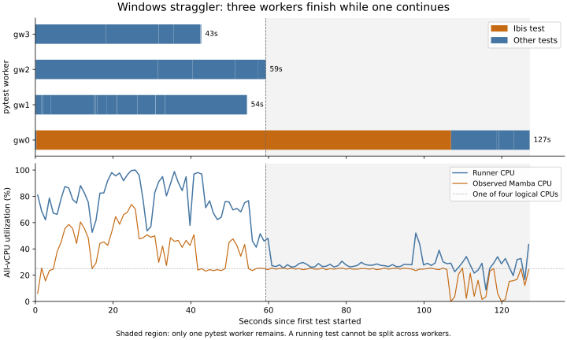

# Windows CI bottleneck investigation — November 4, 2026

This continues the [CPU experiments](CPU-RESULTS.md), using the same frozen
product revision, `b32d4e58b909cc9011684970f621f64f9fe73506`.
The strongest new evidence points to a long-running Mamba subprocess and uneven
work remaining across pytest workers. The observed slow Ibis repeat was not
caused by the shared PyPI mapping download. **Four Windows pytest workers with
`--dist=worksteal` are now supported by a full-matrix comparison:** summed test
time fell 27.3% and the slowest test step fell 25.3% versus two workers with the
default scheduler in these runs. All 44 additional Windows jobs passed.

## What was measured

Two batches each ran Python 3.14 shard 2/4 with cold versus preloaded mapping
caches, two versus four pytest workers, and two repetitions per configuration:
16 jobs in total. All retained the same 86 test IDs. The second batch also
recorded Python stacks every five seconds after a test had run for ten seconds,
plus HTTP timings for an allowlist of public package hosts. HTTP records omit
credentials, headers, and query strings; stack samples omit source text and
local variables. The observer does not change HTTP timeouts or cache behavior.
Python HTTP spans end when `Session.send` returns, so streamed body reads can
extend beyond them; native subprocess HTTP activity is outside this observer.

Preloading uses the real mapping download before pytest; the comparisons count
both the preload and test steps. This prevents moving a wait out of pytest from
being mistaken for eliminating it. Coverage and the existing test assertions
remain enabled. Environment caches are warm; a cold mapping cache is distinct
from a cold Python environment cache.

The observer was validated locally with four processes: one performed a
two-second simulated HTTP request, while three recorded corresponding lock
waits. A separate check verified that HTTP return values, exceptions, and
arguments are preserved, query strings are omitted, and stacks are captured.
The local environment could not import the entire frozen checkout because its
Dulwich version differs from the locked CI environment; the cache-mechanism
smoke test therefore loaded the unchanged `lookup_cache.py` directly. Hosted
trials use the original locked environments and exercise the complete shard.

## Mapping waiting did not explain the new straggler

In [the first batch](https://github.com/maresb/conda-lock/actions/runs/41894213367),
the slowest pytest step took 137s, with Ibis accounting for 106.7s. Its mapping
download took only **0.077s** and its longest mapping lock wait was **0.104s**.
Across both batches, mapping-download spans were at most 1.324s and worker lock
waits at most 0.373s. Preloaded variants avoided the initial shared download
during pytest, but it was already a small part of these jobs.

| Mapping cache | Workers | Batch 1: preparation + pytest, two repeats | Batch 2: preparation + pytest, two repeats |
| --- | ---: | ---: | ---: |
| Cold | 2 | 93s, 73s | 114s, 94s |
| Preloaded | 2 | 82s, 92s | 103s, 117s |
| Cold | 4 | 141s, 74s | 76s, 70s |
| Preloaded | 4 | 79s, 76s | 76s, 73s |

Four workers reduced mean preparation-plus-pytest time from 96.0s to 83.1s
across these focused trials, including the outlier. Preloading alone did not
show a consistent improvement. This is a small, variable sample of one shard;
it is not a full-suite or complete-CI latency estimate.

The earlier 58s simultaneous parsing-test stall did not recur under the new
instrumentation. Its original cause remains unconfirmed. The mapping
download/file-lock explanation remains a hypothesis for that older event,
not an established explanation for every slow run. The lack of an explicit
HTTP timeout is still a separate robustness concern; changing it is not a
measured speed optimization here.

## The long tail is in Mamba, with other workers idle

In the 137s trial, three workers finished their tests after 42.7s, 54.5s, and
59.3s. The final worker continued until 127.2s, including the 106.7s Ibis test
and subsequent queued tests. From approximately 60s to 106s, `mamba.exe`
consumed roughly one logical CPU while overall runner utilization remained
around 25–30%. Additional idle logical CPUs could not execute that test's
already-running native work.

The [stack-sampling batch](https://github.com/maresb/conda-lock/actions/runs/41895411327)
located Ibis's long-running phase at `conda_solver.solve_specs_for_arch`,
waiting for its `mamba create --dry-run --json` subprocess. Almost all Ibis
samples were in that path. Python-side HTTP requests were short in those
repeats. These observations locate the bottleneck in the Mamba invocation;
they do not distinguish native repodata processing from SAT search. That
distinction would require profiling Mamba itself.

## Scheduling within a runner

`pytest-split` balances work between CI jobs. pytest-xdist separately schedules
the selected tests among workers inside each runner. Its default `load`
scheduler can leave queued tests behind a long-running test. The built-in
[`worksteal` scheduler](https://pytest-xdist.readthedocs.io/en/stable/distribution.html)
can move pending tests between workers; it cannot split a running test.

The [focused scheduler comparison](https://github.com/maresb/conda-lock/actions/runs/41895926559)
held four workers and a preloaded mapping cache constant. All four jobs passed
the same 86 IDs.

| Metric | Default `load` | `worksteal` |
| --- | ---: | ---: |
| Pytest steps | 78s, 88s | 72s, 74s |
| Mean pytest step | 83s | 73s |
| Mean preparation + pytest | 86.5s | 77.5s |
| Time with only the final worker remaining | 6.8s, 4.8s | 1.5s, 3.5s |

This was a 12.0% reduction in pytest time and a 10.4% reduction including
preparation. Full-matrix validation is reported below.

## Full Windows matrix validation

The [paired worker-count matrix](https://github.com/maresb/conda-lock/actions/runs/41896572018)
ran two and four workers with default scheduling. The subsequent
[`worksteal` matrix](https://github.com/maresb/conda-lock/actions/runs/41896915856)
ran four workers. Each configuration used four shards per Python version,
covering Python 3.11 and 3.14. All 24 jobs passed and restored their environment
caches. Every configuration retained exactly 344 test IDs per Python, with
no duplicates or omissions, and identical IDs in corresponding shards.

These full-matrix runs retain the ordinary cold mapping-cache behavior and
omit the Python stack/HTTP observer. They use the same one-second resource
sampler as the original CPU experiments, along with coverage and duration
collection. Thus the result does not require adding mapping preloading or
diagnostic hooks to production CI.

| Metric | 2 workers, `load` | 4 workers, `load` | 4 workers, `worksteal` |
| --- | ---: | ---: | ---: |
| Time-weighted CPU utilization | 39.3% | 65.9% | 71.7% |
| Sum of eight pytest steps | 977s | 773s | 710s |
| Slowest pytest step | 158s | 125s | 118s |
| System CPU-seconds in sampled test phases | 1,533 | 2,032 | 2,032 |

Four workers alone reduced summed test time by 20.9% and the slowest step by
20.9% in this repeat. `worksteal` then reduced summed time by another 8.2% and
the slowest step by 5.6%. The combined reduction is **27.3% in summed pytest
time and 40s (25.3%) in the longest test step**. More worker processes consumed
more CPU-seconds, while finishing sooner.

This updates the earlier recommendation to retain two Windows workers while
the evidence was inconclusive. Use explicit `--numprocesses=4` on Windows and
`--dist=worksteal`; retain the earlier four-worker Linux recommendation.
The Windows scheduler change also passed two focused repetitions before this
full-matrix validation. Nevertheless, these are small trial sets, not a stable
latency distribution: the earlier full worker-count pair showed little benefit
because of an outlier, and the Mamba tail remains variable. The original
58s parsing stall is still not explained.

The two worker-count settings shared a run, while `worksteal` was a later run
that briefly overlapped its completion. Comparisons use individual step times,
not queue-dependent workflow spans. No complete-CI speedup is claimed.

## macOS and revision scope

The [new macOS probe](https://github.com/maresb/conda-lock/actions/runs/41894213367/job/126799415452)
again failed to acquire a hosted runner after approximately 15 minutes.
GitHub's annotations explicitly report macOS arm64 capacity constraints.
Recent upstream jobs did receive macOS runners, but this fork's probe did not.
There are still no macOS utilization measurements or measured complete-CI
candidate completion times.

PR #972 now has head `e1ba99e80a09c768db7fed046248763a8e79859d`.
[Changes since the frozen revision](https://github.com/conda/conda-lock/compare/b32d4e58b909cc9011684970f621f64f9fe73506...e1ba99e80a09c768db7fed046248763a8e79859d)
leave the mapping implementation and runtime package versions unchanged, while
updating the integration bootstrap, a separate virtualenv test, and obsolete
type stubs. The frozen revision keeps these trials comparable; their timings
must not be relabeled as measurements of the newer integration workflow.

## Implications for #969

Duration refresh helps keep job-level shard estimates current. It cannot split
one long Mamba solve, remove the cross-platform integration barrier, or directly
balance pytest workers inside a runner. After changing worker count or
scheduling, collect fresh durations under that configuration before drawing
conclusions about shard balance. Repeated timings matter: a single outlier is
not a reliable estimate of a test's typical cost.

The earlier integration recommendations still address the original critical
path: independent OS/Python pipelines and parallel Windows format checks.
Improving pytest alone does not establish a reduction of the original 10m35s
integration completion time.

For subsequent optimization, profile the Ibis test's Mamba invocation before
changing its fixture or constraints. Python stack samples locate that boundary
but cannot justify removing dependencies or reducing regression coverage.

## Reproduction and evidence

The fork branch contains `mapping_probe.py`, `analyze_mapping.py`,
`plot_worker_tail.py`, and generated workflows for all variants. Run
`instrument.py` to regenerate the workflows. Raw `metrics-*` artifacts contain
CPU/I/O samples, mapping events, per-worker test reports, stack/HTTP samples
where enabled, and the unmodified duration output. The local evidence root is
`/tmp/conda-lock-cpu-20261104`; observer validation lives under
`/tmp/conda-lock-mapping-20261104`.

[`followup-results.json`](followup-results.json) preserves individual trial
results, full-matrix comparisons, cache-hit/worker-count validation, and the
macOS failure annotations. [`cpu-phase-summary.csv`](cpu-phase-summary.csv)
includes the expanded resource measurements. `analyze_worker_matrix.py`
reproduces the full-matrix comparison and asserts identical shard IDs and the
same 344 IDs per Python as the earlier baseline.
